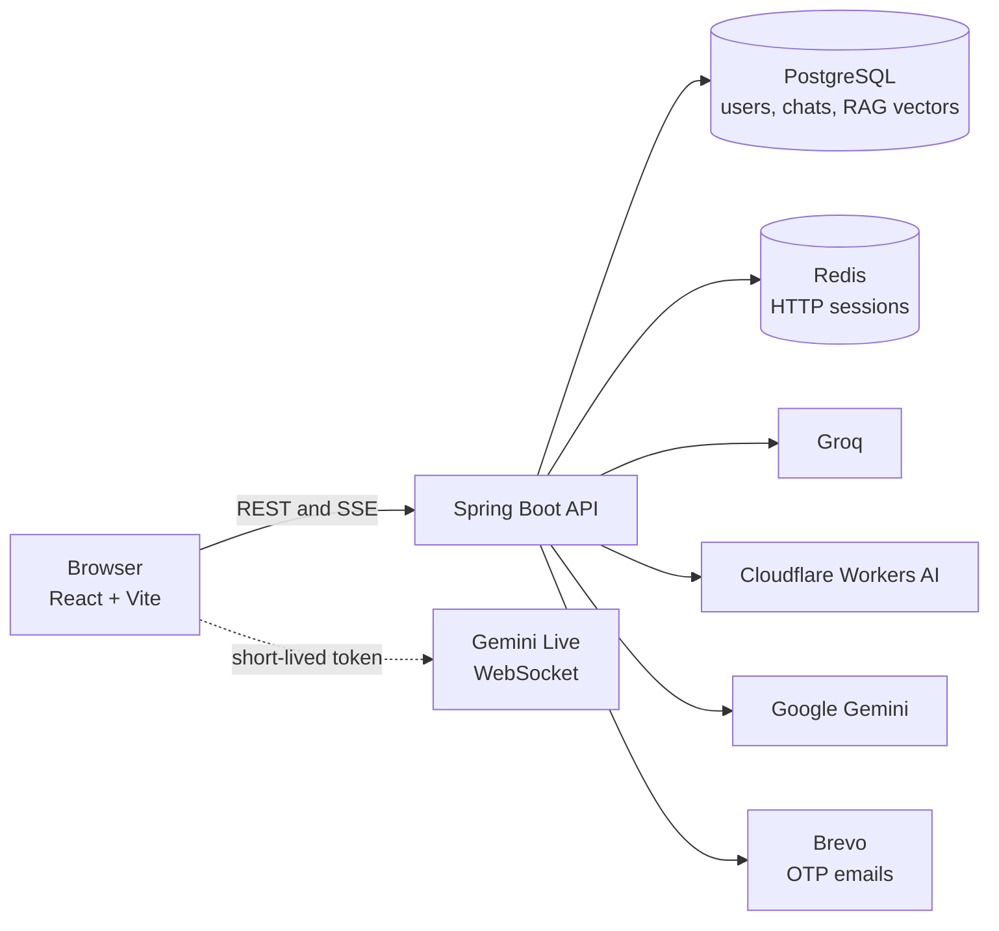

<div align="center">


# Twinkle AI

**Chat, files, document-grounded answers and real-time voice, all in one workspace.**

<br />

[](https://twinkleai.vercel.app)

[](https://react.dev/)
[](https://www.typescriptlang.org/)
[](https://vite.dev/)
[](https://tailwindcss.com/)
[](https://spring.io/projects/spring-boot)
[](https://openjdk.org/)
[](https://www.postgresql.org/)
[](https://redis.io/)
[](backend/Dockerfile)

[Features](#features) ·
[Quick Start](#quick-start) ·
[Configuration](#configuration) ·
[API](#api-reference) ·
[Deployment](#deployment) ·
[Troubleshooting](#troubleshooting)

</div>

---

## ✨ Overview

Twinkle AI is a multi-user AI chat application. A React + TypeScript frontend talks to a Spring Boot REST API. PostgreSQL stores accounts, chats and knowledge-base vectors, Redis stores login sessions, and the AI work is done by Groq, Cloudflare Workers AI and Google Gemini.

| 💬 Chat | 🧠 Knowledge Base | 🎙️ Live Talk | 🔐 Accounts |
|:---:|:---:|:---:|:---:|
| Streaming replies, model picker, history, search and share links | Upload documents, ask questions, get cited source excerpts | Real-time voice conversations with 30 selectable voices | Email OTP, Google sign-in, password reset, profile stats |

---

<a id="features"></a>

## 🚀 Features

| Area | What you get |
|:--|:--|
| 💬 **AI Chat** | Switch between several models, streamed responses, Markdown, tables and syntax-highlighted code |
| 📎 **Files and images** | Attach files and images to a message for analysis (Gemini vision, Tesseract OCR in the Docker image) |
| 🖼️ **Image generation** | Cloudflare Workers AI image models (FLUX) with automatic fallback |
| 🧠 **Knowledge Base (RAG)** | Upload a document, it is chunked and embedded, then answers cite the passages they came from |
| 🎙️ **Live Talk** | Voice conversation over Gemini Live, with colour themes and transcript saving |
| 🗂️ **Conversations** | Create, search, rename, pin, group, delete and share chats through public links |
| 🔐 **Authentication** | Email and password with OTP verification, Google OAuth 2.0, forgot and reset password, sign out of all devices |
| 👤 **Profile and Settings** | Profile editing, usage statistics, theme, language, data export and account deletion |
| 🌍 **Multi-language UI** | Interface translation through the backend `/api/i18n/translate` endpoint |
| 🛡️ **Safety** | Rate limiting, session revocation, HTTP-only cookies, health endpoints |

### ⌨️ Keyboard shortcuts

On macOS use <kbd>⌘</kbd> instead of <kbd>Ctrl</kbd>.

| Shortcut | Action |
|:--|:--|
| <kbd>Ctrl</kbd> + <kbd>K</kbd> | Search chats |
| <kbd>Ctrl</kbd> + <kbd>Shift</kbd> + <kbd>O</kbd> | New chat |
| <kbd>Ctrl</kbd> + <kbd>B</kbd> or <kbd>Ctrl</kbd> + <kbd>Shift</kbd> + <kbd>S</kbd> | Toggle sidebar |
| <kbd>Ctrl</kbd> + <kbd>Shift</kbd> + <kbd>L</kbd> | Start Live Talk |
| <kbd>Ctrl</kbd> + <kbd>,</kbd> | Open Settings |
| <kbd>Ctrl</kbd> + <kbd>/</kbd> | Show shortcuts |

---

## 🧰 Tech Stack

| Layer | Technologies |
|:--|:--|
| **Frontend** | React 19, TypeScript, Vite, Tailwind CSS 4, React Router 7, Motion, Lucide icons |
| **Rendering** | react-markdown, remark-gfm, react-syntax-highlighter |
| **Backend** | Java 17, Spring Boot 3.2.4, Spring MVC, Spring Data JPA, Hibernate |
| **Data** | PostgreSQL (chats, users, RAG vectors as JSONB), Redis with Spring Session |
| **AI providers** | Groq, Cloudflare Workers AI, Google Gemini (chat, embeddings, Live) |
| **Documents** | Apache Tika, Tesseract OCR |
| **Auth and email** | BCrypt, Google OAuth 2.0, Nimbus JOSE JWT, Brevo email API |
| **Ops** | Spring Boot Actuator, Springdoc OpenAPI, Docker, Vercel, Render |

---

## 🏗️ Architecture



**How the Knowledge Base works:** upload → Tika extracts text → text is split into overlapping chunks → Gemini embeds them → the question is embedded and the closest chunks (cosine similarity) are sent to Gemini → you get an answer plus source excerpts.

| RAG setting | Default |
|:--|:--|
| Embedding model | `gemini-embedding-001` |
| Chunk size / overlap | about 1,000 / 150 characters |
| Chunks retrieved | Top 5 (similarity threshold `0.18`) |
| Upload limit | 15 MB per document |

---

<a id="quick-start"></a>

## ⚡ Quick Start

### Prerequisites

| Tool | Version | Used for |
|:--|:--|:--|
| Java | 17+ | Backend |
| Node.js | 20+ | Frontend |
| PostgreSQL | any recent | Data |
| Redis | any recent | Sessions |
| API keys | Groq, Gemini, Brevo, Google OAuth | AI, email, sign-in |

### 1. Clone

```bash
git clone https://github.com/<your-username>/Twinkle-AI.git
cd Twinkle-AI
```

### 2. Create the database tables

Chat and user tables are created by Hibernate (`DDL_AUTO=update`). The Knowledge Base tables are not, so run the SQL file once:

```bash
psql "$DB_URL_WITHOUT_JDBC_PREFIX" -f backend/src/main/resources/schema.sql
```

### 3. Start the backend

Set the [required variables](#configuration) (a `.env` file inside `backend/` is also read), then:

```bash
cd backend
./mvnw spring-boot:run          # Windows: mvnw.cmd spring-boot:run
```

For plain `http://localhost` development, add these so the session cookie is accepted by the browser:

```bash
SESSION_COOKIE_SECURE=false
SESSION_COOKIE_SAME_SITE=Lax
```

The API runs on **http://localhost:8080**.

### 4. Start the frontend

```bash
cd frontend
echo "VITE_API_BASE_URL=http://localhost:8080/api" > .env.local
npm install
npm run dev
```

Open **http://localhost:5173**.

### Run the backend with Docker

```bash
cd backend
docker build -t twinkle-backend .
docker run -p 8080:8080 --env-file .env twinkle-backend
```

---

<a id="configuration"></a>

## ⚙️ Configuration

> [!IMPORTANT]
> Never commit `.env` files or keys. Set secrets in your shell or in your hosting provider's secret manager.

### Required (the backend will not start without these)

| Variable | Description |
|:--|:--|
| `DB_URL`, `DB_USERNAME`, `DB_PASSWORD` | PostgreSQL JDBC URL and credentials |
| `REDIS_URL` | Redis connection URL |
| `SESSION_COOKIE_MAX_AGE` | Cookie lifetime in seconds, for example `86400` |
| `SESSION_TIMEOUT` | Session timeout, for example `24h` |
| `GROQ_API_KEY` | Groq API key |
| `GEMINI_API_KEY` | Gemini API key (chat, RAG, Live Talk) |
| `OAUTH_GOOGLE_CLIENT_ID`, `OAUTH_GOOGLE_CLIENT_SECRET` | Google OAuth credentials |
| `OAUTH_GOOGLE_REDIRECT_URI` | For example `https://your-frontend/api/auth/oauth/google/callback` |
| `OAUTH_STATE_SECRET` | Long random string used to sign the OAuth state |
| `BREVO_API_KEY`, `BREVO_SENDER_EMAIL`, `EMAIL_SENDER` | OTP email delivery |

### Optional

| Variable | Default | Description |
|:--|:--|:--|
| `PORT` | `8080` | Server port |
| `FRONTEND_URL` | `https://twinkleai.vercel.app` | Frontend origin used in emails and redirects |
| `CORS_ALLOWED_ORIGINS` | Vercel app and localhost ports | Comma-separated allowed origins |
| `SESSION_COOKIE_SECURE` / `_SAME_SITE` / `_HTTP_ONLY` | `true` / `None` / `true` | Cookie flags |
| `GROQ_MODEL`, `GROQ_MODELS`, `GROQ_VISION_MODELS` | see `application.properties` | Default, available and vision models |
| `CLOUDFLARE_ACCOUNT_ID`, `CLOUDFLARE_API_TOKEN` | empty | Enables Workers AI chat and image models |
| `CLOUDFLARE_MODELS`, `CLOUDFLARE_IMAGE_MODEL` | see `application.properties` | Workers AI model lists |
| `GEMINI_MODEL`, `GEMINI_LIVE_MODEL` | see `application.properties` | Gemini chat and Live models |
| `TWINKLE_RAG_EMBEDDING_MODEL`, `TWINKLE_RAG_CHAT_MODEL` | `gemini-embedding-001`, `GEMINI_MODEL` | RAG models |
| `OTP_EXPIRATION_MINUTES`, `OTP_LENGTH` | `10`, `6` | OTP behaviour |
| `MAX_FILE_SIZE`, `MAX_REQUEST_SIZE` | `15MB`, `25MB` | Upload limits |
| `DDL_AUTO` | `update` | Hibernate schema mode (use `validate` in production) |
| `SWAGGER_ENABLED` | `false` | Set `true` to expose Swagger UI |

### Frontend

| Variable | Default | Description |
|:--|:--|:--|
| `VITE_API_BASE_URL` | `/api` | Backend API base URL. The default relies on the Vercel rewrite in `frontend/vercel.json` |

---

<a id="api-reference"></a>

## 📡 API Reference

All routes are prefixed with the host (for example `http://localhost:8080`). Interactive docs are available at `/swagger-ui.html` when `SWAGGER_ENABLED=true`.

<details open>
<summary><b>🔐 Authentication</b> — <code>/api/auth</code></summary>

| Method | Endpoint | Purpose |
|:--:|:--|:--|
| `POST` | `/signup` · `/request-otp` · `/verify-otp` · `/resend-otp` | Register and verify by email |
| `POST` | `/login` · `/logout` · `/logout-all` | Sign in and out |
| `GET` | `/status` · `/me` | Session status and current user |
| `PATCH` | `/profile` | Update profile |
| `GET` | `/profile/stats` | Usage statistics |
| `POST` | `/forgot-password` · `/reset-password` | Password recovery |
| `DELETE` | `/account` | Delete account |
| `GET` | `/oauth/google` · `/oauth/google/callback` | Google sign-in |

</details>

<details open>
<summary><b>💬 Chat</b> — <code>/api/chat</code></summary>

| Method | Endpoint | Purpose |
|:--:|:--|:--|
| `GET` | `/models` | Available models |
| `POST` | `/send` | Send a message (JSON or multipart with files) |
| `POST` | `/send/stream` | Streamed reply (SSE) |
| `GET` | `/sessions` · `/history/{sessionId}` · `/search` | List, read and search chats |
| `POST` | `/new-session` · `/generate-title` · `/import` | Create, title and import chats |
| `PATCH` | `/rename` | Rename a chat |
| `DELETE` | `/session/{sessionId}` · `/sessions` | Delete one or all chats |
| `POST` / `GET` / `DELETE` | `/session/{id}/share`, `/shares`, `/shared/{token}` | Manage and view share links |
| `POST` | `/live/turn` · `/live-save` | Save Live Talk transcripts |

</details>

<details open>
<summary><b>🧠 Knowledge Base, Live Talk and system</b></summary>

| Method | Endpoint | Purpose |
|:--:|:--|:--|
| `POST` | `/api/rag/documents` | Upload and index a document |
| `GET` | `/api/rag/documents` | List your documents |
| `DELETE` | `/api/rag/documents/{id}` | Delete a document |
| `POST` | `/api/rag/ask` | Ask a question over your documents |
| `POST` | `/api/live/token` | Create a short-lived Live Talk token |
| `POST` | `/api/i18n/translate` | Translate UI text |
| `GET` | `/health` · `/api/health` | Health checks |

</details>

---

<a id="deployment"></a>

## 🌐 Deployment

| Part | Platform | Steps |
|:--|:--|:--|
| **Frontend** | Vercel | Import the `frontend/` folder. Edit the backend URL in `frontend/vercel.json` to your own API host. Every other path falls back to `index.html`. |
| **Backend** | Render, Railway, Fly.io or any Docker host | Build from `backend/Dockerfile`, add the required variables, and attach PostgreSQL and Redis. |
| **Database** | Neon or any PostgreSQL | Run `schema.sql` once for the Knowledge Base tables. |

Checklist after deploying: the health endpoint returns `UP`, `FRONTEND_URL`, `CORS_ALLOWED_ORIGINS` and `OAUTH_GOOGLE_REDIRECT_URI` match your real domains, and cookies are `Secure` with `SameSite=None` when the frontend and API are on different domains.

---

## 📁 Project Structure

```text
Twinkle-AI/
├── backend/                         Spring Boot API
│   ├── Dockerfile
│   ├── pom.xml
│   └── src/main/
│       ├── java/com/ai/chatbot_backend/
│       │   ├── controller/          REST endpoints (auth, chat, rag, live, i18n, health)
│       │   ├── service/             Business logic and AI provider clients
│       │   ├── repository/          Spring Data repositories
│       │   ├── dto/                 Entities and request/response objects
│       │   ├── config/              CORS, rate limiting, sessions, Redis
│       │   ├── redis/               Redis event listener
│       │   └── exception/           Global error handling
│       └── resources/
│           ├── application.properties
│           └── schema.sql           Knowledge Base tables
└── frontend/                        React + Vite app
    ├── public/                      Logo, favicon, login hero video
    ├── vercel.json                  API proxy and SPA rewrites
    └── src/
        ├── pages/                   Chat, Login, Settings, Profile, KnowledgeBase, SharedChat…
        ├── components/              Sidebar, modals, Live Talk, toasts…
        ├── lib/                     API client, i18n, shortcuts, voices, helpers
        └── audio/                   Microphone PCM capture worklet
```

---

<a id="troubleshooting"></a>

## 🛠️ Troubleshooting

| Problem | Likely cause and fix |
|:--|:--|
| Backend exits with `Could not resolve placeholder` | A required variable is missing. See [Configuration](#configuration). |
| Login works but you are signed out on refresh (local) | Set `SESSION_COOKIE_SECURE=false` and `SESSION_COOKIE_SAME_SITE=Lax` for `http://localhost`. |
| Frontend calls return 404 on `localhost:5173` | Create `frontend/.env.local` with `VITE_API_BASE_URL=http://localhost:8080/api`. |
| CORS error | Add your frontend origin to `CORS_ALLOWED_ORIGINS`. |
| Knowledge Base upload fails | Run `schema.sql`, and check the Gemini key and the 15 MB limit. |
| First request is slow on a free host | Free tiers sleep when idle. The client retries once automatically. |
| Google sign-in redirect error | `OAUTH_GOOGLE_REDIRECT_URI` must exactly match the URI registered in Google Cloud. |

---

## 🔒 Security notes

| Do | Why |
|:--|:--|
| Keep all keys on the backend | The frontend never needs provider keys |
| Use `DDL_AUTO=validate` in production | Prevents accidental schema changes |
| Treat uploaded documents as untrusted | Retrieved text can contain prompt-injection attempts |
| Keep HTTPS, CORS and OAuth redirect URLs consistent | Required for cookie sessions to work safely |

---

<div align="center">

**Built by Azeez** · Java full-stack and AI application development

If Twinkle AI helped you, a ⭐ on the repository is much appreciated.

</div>